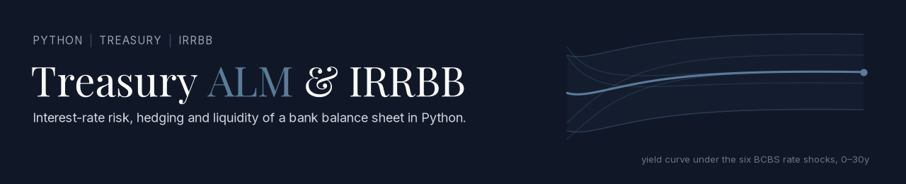
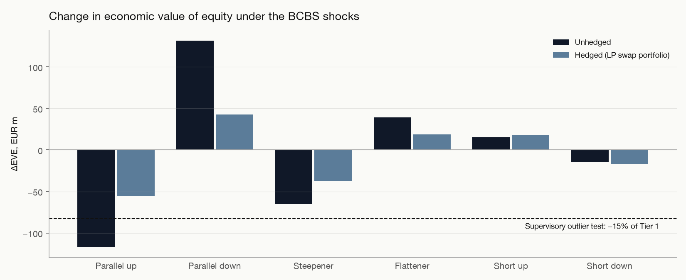
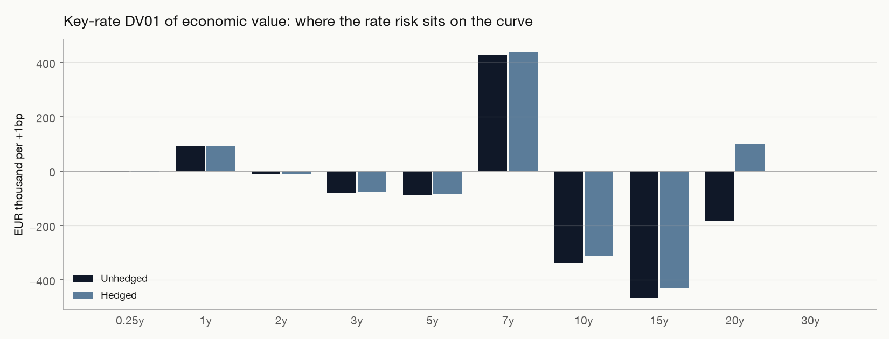

# Treasury ALM & IRRBB

[](https://github.com/Lupikkkk/treasury-alm-irrbb/actions/workflows/tests.yml)

A Python model of what a bank's **Treasury / ALM desk** does with interest-rate risk in the banking book (IRRBB). It follows the desk's workflow:

1. **Measure.** Economic value of equity (EVE) and 12-month net interest income (NII) under the six **BCBS (2016) rate shocks**, with the EBA post-shock floor and the supervisory outlier tests (15% of Tier 1 for EVE, 5% for NII). PV and DV01 per position, and **key-rate DV01** to show where on the curve the risk sits.
2. **Model behaviour.** Mortgage **prepayment** that speeds up when rates fall, **non-maturity deposits** split into core and non-core balances within the BCBS caps, and **deposit betas** estimated with an error-correction model, an **Engle-Granger cointegration test** and an **asymmetric ECM** (banks raise deposit rates and cut them at different speeds).
3. **Hedge.** Swaps priced from the curve, and a **linear programme** that finds the smallest swap portfolio keeping ΔEVE inside a limit in all six scenarios.
4. **Check liquidity.** A simplified Liquidity Coverage Ratio and a day-by-day survival horizon under a deposit run.

The yield-curve fit (Nelson-Siegel-Svensson, the ECB's model), the cointegration test and the hedge optimiser are implemented from scratch. Tests check them against known answers: the Engle-Granger statistic matches `statsmodels` to 1e-8, and the optimiser's prediction matches a full revaluation of the hedged balance sheet.



## The question the project answers

**Is the bank inside its interest-rate risk limit, and what is the cheapest hedge that gets it there?**

A retail bank funds long fixed-rate mortgages with deposits that can be withdrawn any day. When rates rise, the mortgages lose value and the deposits do not, so economic value falls. How much depends on behaviour no contract states: how fast borrowers prepay, how long deposits stay, and how much of a rate rise the bank must pass on to depositors. A hedge that fixes economic value also changes earnings, so the desk has to look at both.

`python main.py` runs the full analysis on an illustrative mid-sized European retail bank and writes every number below to [`reports/summary.md`](reports/summary.md). `python main.py --ecb` repeats it on the ECB AAA euro-area curve and ECB deposit-rate statistics and writes to [`reports/ecb/`](reports/ecb/summary.md).

## Results

The bank: EUR 7.1bn of assets (fixed and floating mortgages, SME and consumer loans, government and covered bonds) funded by EUR 6.5bn of sight, savings, term and corporate deposits, a senior bond and a covered bond. Tier 1 is assumed at EUR 550m. **The balance sheet is made up**, chosen to look like a typical mix, and is not taken from any real bank. The offline run uses an illustrative curve and simulated deposit-rate series. Every number in this section is in [`reports/summary.md`](reports/summary.md).

**ΔEVE under the BCBS shocks** (EUR m, post-shock floor)

| Scenario | ΔEVE | % of Tier 1 | ΔEVE, static prepayment |
|---|---:|---:|---:|
| Parallel up | **−117.2** | **−21.3%** | −108.7 |
| Parallel down | +131.6 | +23.9% | +155.5 |
| Steepener | −65.2 | −11.9% | −63.2 |
| Flattener | +39.2 | +7.1% | +50.1 |
| Short up | +15.1 | +2.7% | +8.9 |
| Short down | −14.0 | −2.6% | −9.1 |

**The bank fails the EVE outlier test.** A parallel +200bp shock takes 21.3% of Tier 1, against a 15% threshold. The key-rate profile shows where the risk sits: −336k, −465k and −183k per basis point at 10, 15 and 20 years (fixed-rate mortgages), partly offset by +428k at 7 years (the bank's own 7-year covered bond). Net DV01 is −647k per basis point.

**Prepayment makes the bank negatively convex.** With a static prepayment speed the bank loses 108.7m when rates rise and gains 155.5m when they fall. Once prepayments respond to rates (BCBS scalars 0.8 and 1.2), the loss grows to 117.2m and the gain shrinks to 131.6m. Borrowers hold on to cheap loans when rates rise and refinance when rates fall, and both hurt the bank.

**ΔNII, 12 months, constant balance sheet** (EUR m)

| Scenario | ΔNII | Zero deposit betas |
|---|---:|---:|
| Parallel up | +10.4 | +25.0 |
| Parallel down | −11.7 | |
| Short up | +8.2 | |
| Short down | −10.3 | |

**Deposit betas cut the earnings gain from higher rates by more than half.** With zero pass-through the bank would earn 25.0m more in a +200bp scenario. With the estimated betas (0.14 on sight deposits, 0.42 on savings) the gain is 10.4m. The effect is asymmetric. Deposit rates are floored at 0%, so when rates fall the bank cannot cut its deposit costs far enough, and it loses 11.7m, more than it gains when rates rise. NII is well inside its own outlier test (−2.1% of Tier 1).

**Hedging** (smallest pay-fixed swap that passes the 15% test)

| Swap tenor | Par rate | Notional, EUR m |
|---|---:|---:|
| 5y | 2.35% | 381 |
| 7y | 2.56% | 286 |
| 10y | 2.80% | 215 |
| 15y | 3.03% | 163 |

**The cheapest hedge is long-dated.** A 5-year swap needs more than twice the notional of a 15-year swap, because it hedges the wrong part of the curve. Asked for a tighter 10% limit across all six scenarios, the linear programme picks a single 20-year pay-fixed swap of EUR 246m, which brings the worst case from −117.2m to −55.0m.

**Hedging economic value costs earnings stability.** The same swap raises ΔNII from +10.4m / −11.7m to +14.1m / −15.4m in the parallel scenarios: its floating leg reprices within three months, its fixed leg does not. This is the standard EVE versus NII trade-off, and it is the reason ALM committees set limits on both.

**Verdict.** The bank's problem is economic value, not earnings. It holds long fixed-rate mortgages against short-repricing funding, and behaviour makes it worse: prepayment shortens the assets just when rates fall, and the deposit floor removes the funding benefit at the same time. A long-dated payer swap of about EUR 250m fixes the EVE breach at the cost of about 4m more NII sensitivity.

**On market data the result holds.** On the ECB AAA curve of 12 November 2026 the parallel-up loss is 110.4m (−20.1% of Tier 1), and the optimiser again picks a single 20-year swap (227m). See [`reports/ecb/summary.md`](reports/ecb/summary.md).



### Deposit betas on ECB data

A long-run beta comes from regressing the deposit rate on the market rate in levels. That regression only means something if the two rates are cointegrated; otherwise it can be spurious. The Engle-Granger test checks this. ECB MIR household deposit rates against 3M Euribor, monthly, to September 2026 ([`reports/ecb/deposit_betas_by_sample.csv`](reports/ecb/deposit_betas_by_sample.csv)):

| Series | Sample | Beta | EG t-stat | 5% critical | Cointegrated |
|---|---|---:|---:|---:|:---:|
| Overnight deposits | 2003–2026 | 0.17 | −0.98 | −3.36 | no |
| Overnight deposits | 2015–2026 | 0.07 | −2.54 | −3.38 | no |
| New term deposits | 2003–2026 | 0.65 | −1.87 | −3.36 | no |
| New term deposits | 2015–2026 | 0.64 | −3.61 | −3.38 | **yes** |

**Only term deposits since 2015 have a reliable long-run beta.** Overnight deposit rates are not cointegrated with Euribor in either sample. Years of negative policy rates, when banks kept retail deposit rates at zero, break the linear long-run relation. A single beta for sight deposits is therefore a modelling choice that should be stress-tested, not a number to read from a regression. The asymmetric ECM points the same way: since 2015, overnight deposit rates moved toward their long-run level with a half-life of about 3 months when they were below it, and about 17 months when they were above it. Rates stuck at the zero floor could not come down.

The offline demo series fail the test too, although they are cointegrated by construction: with one rate cycle in 120 months the test has little power. Unit tests on longer random-walk data show that it detects cointegration and rejects independent random walks.

**Liquidity.** LCR is 320%. Under a deposit run at the LCR run-off rates the bank survives 109 days, 50 days at twice the rates and 29 days at three times.

## Quick start

```bash
pip install -r requirements.txt

python main.py             # offline: illustrative curve, simulated deposit data
streamlit run app.py       # dashboard with a swap-hedge slider and the hedge optimiser
pytest -q                  # 21 tests

# ECB data (internet). --date and --end fix the period, so the run reproduces reports/ecb/;
# omit them for the latest data
python main.py --ecb --date 2026-11-12 --end 2026-09
```

## Project structure

```
alm/
  curve.py          Nelson-Siegel-Svensson model and multi-start fit
  balance_sheet.py  positions, prepayment and NMD cash flows, repricing gap, sample bank
  irrbb.py          BCBS shocks and floor, EVE, NII, key-rate DV01, swap pricing, hedge optimiser
  deposits.py       deposit betas: Engle-Granger test, symmetric and asymmetric ECM, ECB data loader
  liquidity.py      LCR and survival horizon
  data.py           ECB yield-curve loader and offline sample curve
main.py             console report, charts and reports/summary.md
app.py              Streamlit dashboard
tests/              pricing identities, shock shapes, parameter recovery, convexity, LP vs full revaluation,
                    deposit-rate floor, cointegration vs spurious regression, asymmetric pass-through
```

## Methodology

| Component | Method |
|---|---|
| Yield curve | Nelson-Siegel-Svensson, y(t) = β₀ + β₁f₁(t/τ₁) + β₂[f₁(t/τ₁) − e^(−t/τ₁)] + β₃[f₁(t/τ₂) − e^(−t/τ₂)], fitted by non-linear least squares from 12 starting points |
| BCBS shocks | Parallel ±200bp, short ±250bp·e^(−t/4), long ±100bp·(1 − e^(−t/4)); steepener −0.65·short + 0.9·long, flattener 0.8·short − 0.6·long (EUR sizes) |
| Post-shock floor | −150bp at t = 0, rising 3bp per year to 0% at 50 years, or the observed rate if lower (EBA) |
| EVE | PV of asset minus liability cash flows on the shocked zero curve. Floating positions reprice at the next reset |
| Prepayment | Constant CPR, scaled by 0.8 when rates rise and 1.2 when they fall (BCBS standardised scalars) |
| Non-maturity deposits | Non-core share reprices overnight; core share runs off linearly over the behavioural maturity, within the BCBS caps (core ≤ 90% and average life ≤ 5y for transactional retail; 70% and 4.5y for non-transactional) |
| NII | 12 months, constant balance sheet. Repaid principal is reinvested at the shocked rate; deposits reprice by beta × shift, floored at 0% |
| Key-rate DV01 | Triangular 1bp bumps at 10 tenors; they sum to a parallel 1bp move, so key-rate DV01s add up to total DV01 |
| Deposit beta | Engle-Granger two-step ECM: dₜ = a + β·rₜ + uₜ; Δdₜ = c + γ·uₜ₋₁ + φ·Δrₜ + eₜ; half-life = ln 0.5 / ln(1 + γ) |
| Cointegration test | ADF regression on uₜ without constant, lag length by AIC; MacKinnon (2010) critical values for two variables |
| Asymmetric ECM | Δdₜ = c + γ⁺·max(uₜ₋₁, 0) + γ⁻·min(uₜ₋₁, 0) + φ⁺·max(Δrₜ, 0) + φ⁻·min(Δrₜ, 0) + eₜ; t-test of γ⁺ = γ⁻ |
| Swap pricing | Par rate (1 − DF_T) / Σ DFᵢ; pay-fixed swap = long floating leg + short fixed bond |
| Hedge optimiser | min Σ(pᵢ + qᵢ) s.t. d0ₛ + Σ(pᵢ − qᵢ)·dᵢₛ ≥ −limit·Tier 1 in all six scenarios, p, q ≥ 0 (`scipy.optimize.linprog`) |
| LCR | HQLA after haircuts and the 40% Level-2 cap / (outflows − min(inflows, 75% of outflows)) |

## Limitations

- Floating-rate positions reprice at their next reset date, where they are worth par; the spread after the first reset is not valued.
- Prepayment uses a constant CPR with the BCBS scenario scalars. There is no borrower-level refinancing-incentive model.
- Deposit betas apply immediately in the NII simulation. The estimated adjustment speeds are reported but not yet used as a lag.
- The long-run beta comes from the two-step Engle-Granger procedure. When deposit rates lag a long hiking cycle, the levels regression is biased in small samples, and the asymmetric ECM inherits that bias through the estimated residuals. A one-step ARDL/ECM estimate would be more robust. OLS standard errors of the long-run beta are not valid under cointegration and are reported for reference only.
- The optimiser minimises notional, which favours long tenors. A real desk would also weigh carry, liquidity and hedge-accounting constraints.
- Credit spread risk (CSRBB) is not modelled. The LCR uses one run-off rate per bucket, and the survival horizon has no inflows.

---
Author: Artem Lubkivskyi, BSc Economics and Business, Stockholm School of Economics in Riga
